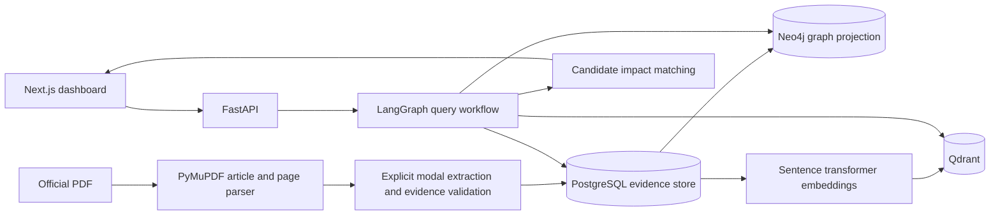

# FinReg Graph

FinReg Graph is a research workspace for tracing financial regulation text to candidate business impacts. It ingests a regulation PDF, preserves article and page references, extracts explicit obligations, indexes passages for search, and shows their connections in a graph. Every returned obligation includes the stored source passage. Business impact labels are interpretations for review, not legal conclusions.

The first supported collection is one version of **Regulation (EU) 2022/2554 (DORA)** and a sample payment fintech profile. Other versions can be uploaded for a text comparison, but extraction quality is only evaluated on the small DORA sample in this repository.

## Architecture



PostgreSQL is the canonical store. Neo4j and Qdrant are rebuildable projections. If either projection is unavailable, upload returns a warning and lexical search continues. The query workflow classifies the query, retrieves passages, expands through their articles, explores the graph, matches a profile where supplied, checks citations, and returns evidence-linked results.

## Run locally with Docker

1. Copy `.env.example` to `.env` and replace `NEO4J_PASSWORD` with a local password of your choice. Keep `.env` out of Git.
2. Start Docker Desktop.
3. Run `docker compose up --build`.
4. Open the web app at `http://localhost:3000`. The API documentation is at `http://localhost:8000/docs`.
5. Download the **English original Official Journal PDF** of [DORA from EUR-Lex](https://eur-lex.europa.eu/eli/reg/2022/2554/oj/eng/pdf). Upload that file in **Documents**, retaining the default regulation ID `EU 2022/2554`, version `OJ 2022-12-27`, and source URL. The app stores the PDF hash and rejects an identical re-upload.
6. In **Impact analysis**, save the prefilled sample payment fintech profile, then run a question. Open source links and review the exact evidence before using any result.

The first run downloads the embedding model and can take several minutes. To enable optional local structured extraction, run `docker compose --profile llm up --build`, pull the configured model into Ollama, and set `ENABLE_LLM=true`. Default extraction uses only explicit `shall`/`must` statements. Ollama extraction is filtered against an exact source quote before storage.

### Local UI preview without Docker

With Python 3.12 and Node 20 or newer installed, run:

On Homebrew installations where `node@20` is not linked, first run `export PATH="$(brew --prefix node@20)/bin:$PATH"`.

```bash
python3.12 -m venv .venv
.venv/bin/pip install -e './backend[dev]'
cd web && npm ci && cd ..
bash scripts/preview-local.sh
```

Open `http://127.0.0.1:3000`. This preview uses SQLite and lexical retrieval. The knowledge graph screen reads the canonical SQL evidence store; Neo4j and Qdrant are optional services for this preview. Download the official DORA PDF above and upload it in **Documents**. The screens have direct routes: `/documents`, `/search`, `/graph`, and `/impact`.

### API examples

```bash
curl -F file=@dora.pdf -F title='Digital Operational Resilience Act' \
  -F regulation_id='EU 2022/2554' -F version='OJ 2022-12-27' \
  -F source_url='https://eur-lex.europa.eu/eli/reg/2022/2554/oj/eng/pdf' \
  http://localhost:8000/documents

curl -H 'Content-Type: application/json' -d '{"question":"What ICT risk management obligations are stated?"}' \
  http://localhost:8000/query
```

The UI offers document management, article and obligation graph exploration, search with evidence cards, a business profile editor, impact review, JSON report download, and text diffs between uploaded versions. The `/compare` endpoint reports changed article text; it does not characterize the legal significance of a change.

## Tests and evaluation

With Python 3.12 and package access:

```bash
python3.12 -m venv .venv
.venv/bin/pip install -e './backend[dev]'
.venv/bin/ruff check backend
.venv/bin/pytest backend/tests -q
cd backend && ../.venv/bin/python -m evaluation.run
```

With Node 22:

```bash
cd web
npm install
npx tsc --noEmit
npm run build
```

The test suite checks page/article preservation, conservative extraction, citation validation, and upload-to-query evidence flow. `backend/evaluation/gold.json` is a small manually labeled DORA excerpt set with one synthetic negative example. `evaluation.run` reports entity precision, recall, F1, lexical recall@1, article expansion recall@2, citation accuracy, and unsupported extracted claims. These numbers describe that tiny dataset only; they are not a production benchmark. RAGAS is an optional dependency for a larger, separately curated answer evaluation set.

GitHub Actions runs Ruff, pytest, TypeScript checking, and a frontend build on pushes and pull requests.

## Assumptions and limits

- The uploaded document is a text PDF with standalone `Article N` headings. Scanned PDFs need OCR before upload. PyMuPDF preserves page numbers; PDF layout can still cause paragraph boundaries to be imperfect.
- An explicit `shall` or `must` sentence is an **obligation candidate**. The extractor does not resolve exceptions, amendments, cross-references, definitions, or jurisdictional scope. An exact source quote is required before storage.
- Exact-span entity hints cover selected organizations, regulated entities, products, concepts, and deadlines. spaCy NER adds hints when `en_core_web_sm` is installed. Hints are mentions, not validated legal classifications. The graph contains regulation, article, obligation, and entity nodes. The current business process match is keyword based. Classification values `potential`, `review`, and `unclear` are review priorities, not compliance determinations.
- The basic UI has no accounts or tenant isolation. Do not expose it publicly or upload confidential documents without adding authentication, authorization, encryption, retention controls, and an operational security review.
- Graph and vector projections are best effort and can warn on upload. This MVP does not yet provide background jobs, projection retries, OCR, automated legal updates, or a validated high recall extraction model.

The authoritative text and status of DORA should always be checked on [EUR-Lex](https://eur-lex.europa.eu/eli/reg/2022/2554/oj). This application is not legal advice.

## Repository map

| Path | Purpose |
| --- | --- |
| `backend/finreg/ingestion.py` | Page and article extraction |
| `backend/finreg/nlp.py` | Conservative obligation extraction and source validation |
| `backend/finreg/graph.py` | Neo4j projection and traversal |
| `backend/finreg/retrieval.py` | Qdrant indexing, lexical baseline, article expansion |
| `backend/finreg/workflow.py` | LangGraph query pipeline |
| `backend/finreg/impact.py` | Heuristic business candidate matching |
| `backend/migrations` | PostgreSQL schema migration |
| `backend/evaluation` | Labeled examples and metrics |
| `web/src/app/page.tsx` | Dashboard and review flows |

## Demo walkthrough

After uploading DORA, show the overview counts, inspect the knowledge graph, search for `ICT risk management`, open an evidence card and its official source, save the sample profile, run impact analysis, and download the JSON report. To demonstrate version comparison, upload a second, explicitly versioned PDF and select both documents in **Documents**. The version diff is a document comparison, not a legal change assessment.
